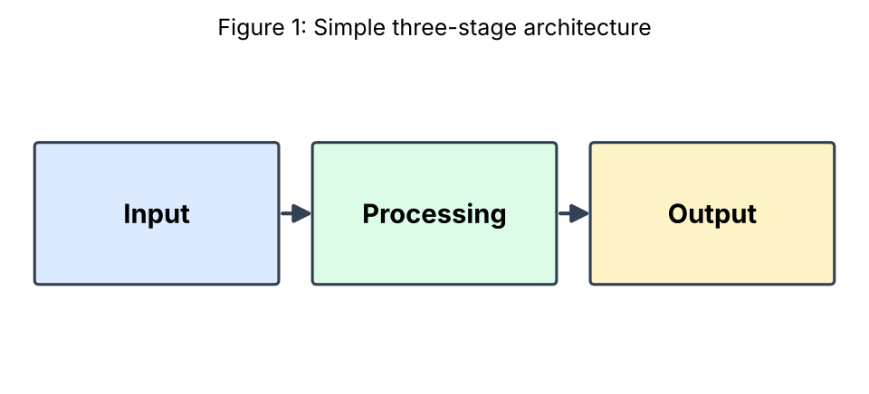
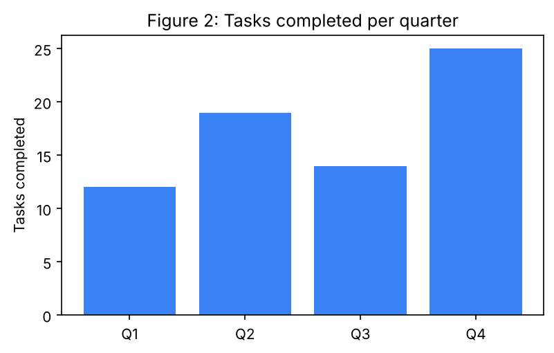

{width=25%}

# 1. Introduction

This handbook is a **test document** for checking Markdown export with embedded pictures.
It uses a neutral example project called *Sample Project*.

> **Note:** If you can read this in Zettlr and the exported files, Pandoc works correctly.

# 2. Architecture

The system has three stages, shown in the figure below.

{width=90%}

## 2.1 Stages

| Stage | Purpose | Owner |
|-------|---------|-------|
| Input | Collects data | Team A |
| Processing | Transforms data | Team B |
| Output | Delivers results | Team C |

## 2.2 Example configuration

```bash
./run --input data.csv --output result.json
```

# 3. Progress

The chart shows completed tasks per quarter.

{width=70%}

Key points:

1. Q4 had the highest output.
2. Q3 dipped compared to Q2.
3. The trend over the year is positive.

# 4. Glossary

Term
:   Definition of the term, written as a definition list.

Handbook
:   A document that explains a project to its readers.

# 5. Next steps

- [x] Write the handbook source
- [x] Add pictures
- [ ] Export to HTML, PDF, Word and ePub
