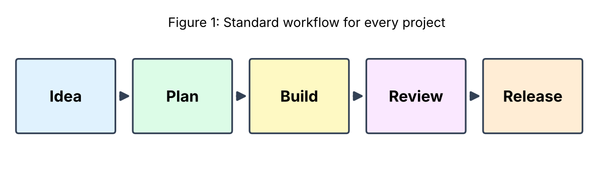

# Working together

## Communication

We use three channels, each for a different purpose:

- **Chat** for quick questions and everyday coordination.
- **E-mail** for formal communication with customers and partners.
- **The issue tracker** for everything that needs a decision, an owner or a deadline.

::: {.callout-tip}
If a chat discussion lasts longer than ten minutes, move it to a short call and write a summary in the issue tracker.
:::

## Meetings

| Meeting | Length | Purpose |
|---------|--------|---------|
| Weekly team meeting | 30 min | Status, blockers, upcoming work |
| Monthly review | 60 min | What we finished and what we change |
| Quarterly planning | half a day | Goals for the next three months |

Every meeting has an agenda before it starts and a short written result afterwards.

## Working hours

Core hours are **10:00 to 15:00**. Outside core hours everyone chooses their own schedule. Please enter absences in the shared calendar early.

## How we build products

All projects follow the same five stages.

{width=90%}

::: {.callout-note collapse="true"}
## Details of the review stage
A review checks four things: does the change solve the described problem, is it understandable, is it tested, and does it follow the guidelines. Reviews comment on the work, never on the person.
:::
