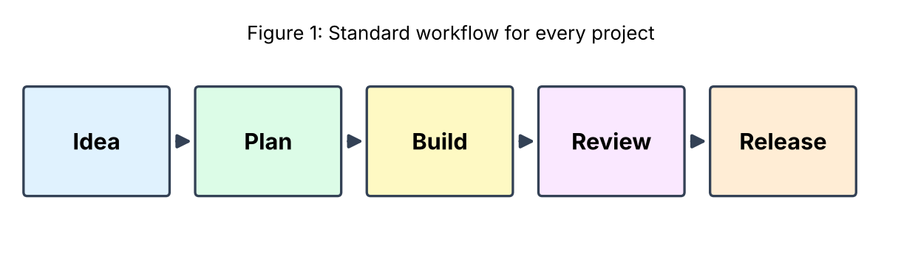

# Welcome

Welcome to **Example Company**. This handbook explains how our team works, which tools we use and what we expect from each other. It is written for new colleagues, but it is also the place where experienced team members look things up.

The handbook is a living document. If something is unclear, outdated or missing, please change it. Every improvement helps the next person who reads it.

## Purpose of this handbook

The handbook has four goals:

1. Give new colleagues a fast and calm start.
2. Describe our working agreements in one place.
3. Reduce questions that are answered the same way every time.
4. Make our decisions visible, so that nobody has to guess why we do things in a certain way.

## Who should read it

Everyone. Developers, designers, project leads and administrative staff all follow the same basic rules. Where a section applies only to a certain role, the text says so clearly.

> **Note:** This handbook is a template with fictional content. Replace the company name, the logo and the example rules with your own.

# About the company

Example Company builds reliable software and hardware products for small and medium-sized customers. We value clear communication, simple solutions and long-term quality over short-term speed.

## Mission

We deliver products that work every day without drawing attention to themselves. A good product is one that customers can forget about, because it simply does its job.

## Values

| Value | What it means in practice |
|-------|---------------------------|
| Clarity | We write things down and say what we mean. |
| Quality | We finish what we start and test before we ship. |
| Respect | We assume good intent and give honest feedback. |
| Curiosity | We learn from mistakes and share what we find out. |
| Ownership | We take responsibility for results, not only for tasks. |

## Organisation

The company is organised in small teams. Each team owns a product or a service from the first idea to the day it is retired. Teams decide how they work, as long as they follow the shared rules in this handbook.

| Team | Responsibility | Typical size |
|------|----------------|--------------|
| Product | Requirements, priorities, customer contact | 2–3 people |
| Engineering | Design, implementation, testing | 4–8 people |
| Operations | Infrastructure, deployment, monitoring | 2–3 people |
| Administration | Contracts, finance, personnel | 2 people |

# Working together

## Communication

We use three channels, each for a different purpose:

- **Chat** for quick questions and everyday coordination. Answers are welcome, but not expected immediately.
- **E-mail** for formal communication with customers and partners.
- **The issue tracker** for everything that needs a decision, an owner or a deadline.

If a discussion in chat lasts longer than ten minutes, move it to a short call or write a short summary in the issue tracker. Decisions that exist only in a chat history are easy to lose.

## Meetings

Meetings are expensive, so every meeting needs a reason. We keep three regular meetings:

1. **Weekly team meeting** (30 minutes): status, blockers, upcoming work.
2. **Monthly review** (60 minutes): what we finished, what we learned, what we change.
3. **Quarterly planning** (half a day): goals for the next three months.

Every meeting has an agenda before it starts and a short written result afterwards. If there is no agenda, the meeting can be cancelled.

## Working hours and availability

We trust each other to organise the working day sensibly. Core hours are **10:00 to 15:00**, when most colleagues are available for questions and meetings. Outside core hours, everyone chooses their own schedule.

Please enter absences in the shared calendar as early as possible, so that teams can plan around them.

## Feedback

Feedback is part of normal work. We give it early, privately and with concrete examples. When receiving feedback, we first listen and ask questions, and decide afterwards what to do with it.

# How we build products

All projects follow the same simple workflow, shown in Figure 1. The details can differ between teams, but the five stages stay the same.

{width=95%}

## Stage 1: Idea

An idea is written down in the issue tracker with a short description of the problem it solves. We do not discuss solutions before the problem is clear.

## Stage 2: Plan

The team estimates the effort, names an owner and splits the work into small tasks. A task should be small enough to finish within two or three days. Larger tasks are split further.

## Stage 3: Build

During implementation we work in short branches and merge often. Each change is small, understandable and tested. Large changes that touch many files at once are avoided, because they are hard to review.

## Stage 4: Review

Every change is reviewed by at least one other person before it is merged. A review checks four things:

- Does the change solve the described problem?
- Is it understandable without extra explanation?
- Is it tested?
- Does it follow the guidelines in this handbook?

Reviews are friendly and specific. We comment on the work, never on the person.

## Stage 5: Release

A release is prepared, tested and announced. The release process is described in its own chapter below.

# Engineering guidelines

## Code style

Consistent code is easier to read and cheaper to maintain. Each repository contains a formatting configuration, and the formatter runs automatically before each commit. Style discussions are settled by the configuration, not by opinion.

General rules:

- Names describe purpose, not type. Prefer `retry_count` over `n`.
- Functions do one thing and fit on one screen.
- Comments explain *why*, not *what*.
- Dead code is deleted, not commented out.

## Version control

We use Git with short-lived branches. The main branch is always in a working state. A typical day looks like this:

```bash
git switch -c fix-login-timeout
# ... edit and test ...
git add -p
git commit -m "Fix timeout when the login server is slow"
git push -u origin fix-login-timeout
```

Commit messages have a short summary line of at most 72 characters, written in the imperative. If more explanation is needed, it follows after an empty line.

## Testing

Every feature and every bug fix comes with a test. We distinguish three levels:

| Level | Scope | Runs |
|-------|-------|------|
| Unit test | One function or class | On every commit |
| Integration test | Several parts together | On every merge request |
| System test | The whole product | Before every release |

A failing test is never ignored. If a test is unreliable, it is fixed or removed quickly, because unreliable tests destroy trust in all other tests.

## Documentation

We document what is hard to see in the code: the purpose of a component, how its parts fit together and how to run it. Documentation lives next to the code in plain text files and is reviewed like code.

Each repository contains at least:

- a `README` with purpose, setup and usage,
- a short description of the architecture,
- a changelog that lists user-visible changes.

# Release process

A release is a promise to our customers, so we treat it with care.

## Preparing a release

1. Freeze the feature list and merge only bug fixes.
2. Update the version number and the changelog.
3. Run all test levels and record the results.
4. Create a release candidate and test it on a clean system.

## Version numbers

We use three-part version numbers in the form `MAJOR.MINOR.PATCH`:

- **MAJOR** changes when existing behaviour breaks.
- **MINOR** changes when new features are added in a compatible way.
- **PATCH** changes for bug fixes only.

## Release checklist

- [x] All planned tasks are closed or moved to the next release
- [x] Tests pass on the release candidate
- [x] Changelog and documentation are updated
- [ ] Customers are informed
- [ ] Release is tagged in version control
- [ ] Monitoring is watched for 48 hours after the release

# Support and incidents

## Customer support

Customer requests are answered within **one working day**. The first answer does not have to contain the solution, but it must confirm that we received the request and name a next step.

## Handling incidents

An incident is any unplanned problem that affects customers. When an incident happens, we follow these steps:

1. **Detect** — someone notices the problem and reports it.
2. **Contain** — reduce the impact first, even with a temporary measure.
3. **Fix** — correct the cause once the situation is stable.
4. **Review** — write a short report without assigning blame.

The report answers three questions: What happened? Why did it happen? What do we change so that it does not happen again?

# Security and data protection

Security is everyone's job, not only the job of one team.

## Everyday rules

- Use a password manager and a unique password for every service.
- Enable two-factor authentication wherever it is offered.
- Lock your screen when you leave your desk.
- Do not store customer data on private devices.
- Report lost devices and suspicious messages immediately.

## Personal data

We collect only the personal data that we need and keep it only as long as necessary. Questions about data protection go to the person responsible for data protection in the administration team.

# Onboarding checklist

New colleagues work through this list in their first two weeks. Their mentor checks off each item together with them.

**Week 1**

- [ ] Receive laptop, accounts and access cards
- [ ] Read this handbook
- [ ] Meet the team and your mentor
- [ ] Set up the development environment
- [ ] Complete a small first task and have it reviewed

**Week 2**

- [ ] Take part in a weekly team meeting
- [ ] Review a colleague's change
- [ ] Present your first impressions and open questions
- [ ] Agree on goals for the first three months

# Glossary

Backlog
:   The ordered list of work that the team plans to do.

Changelog
:   A file that lists the visible changes of each release.

Incident
:   An unplanned problem that affects customers.

Merge request
:   A proposal to add a change to the main branch, including its review.

Release candidate
:   A version that is believed to be ready for release and is tested a final time.

# Document history

| Version | Date | Change |
|---------|------|--------|
| 1.0 | November 2026 | First version |
